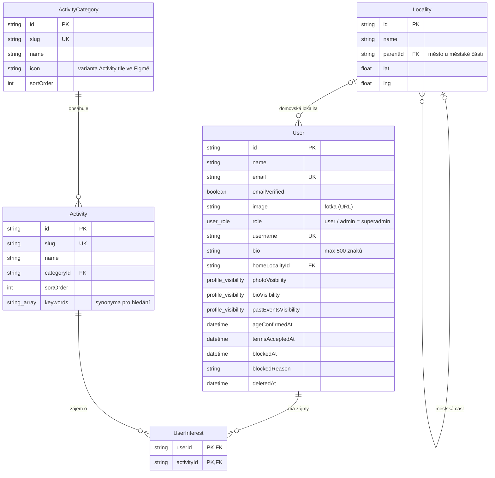
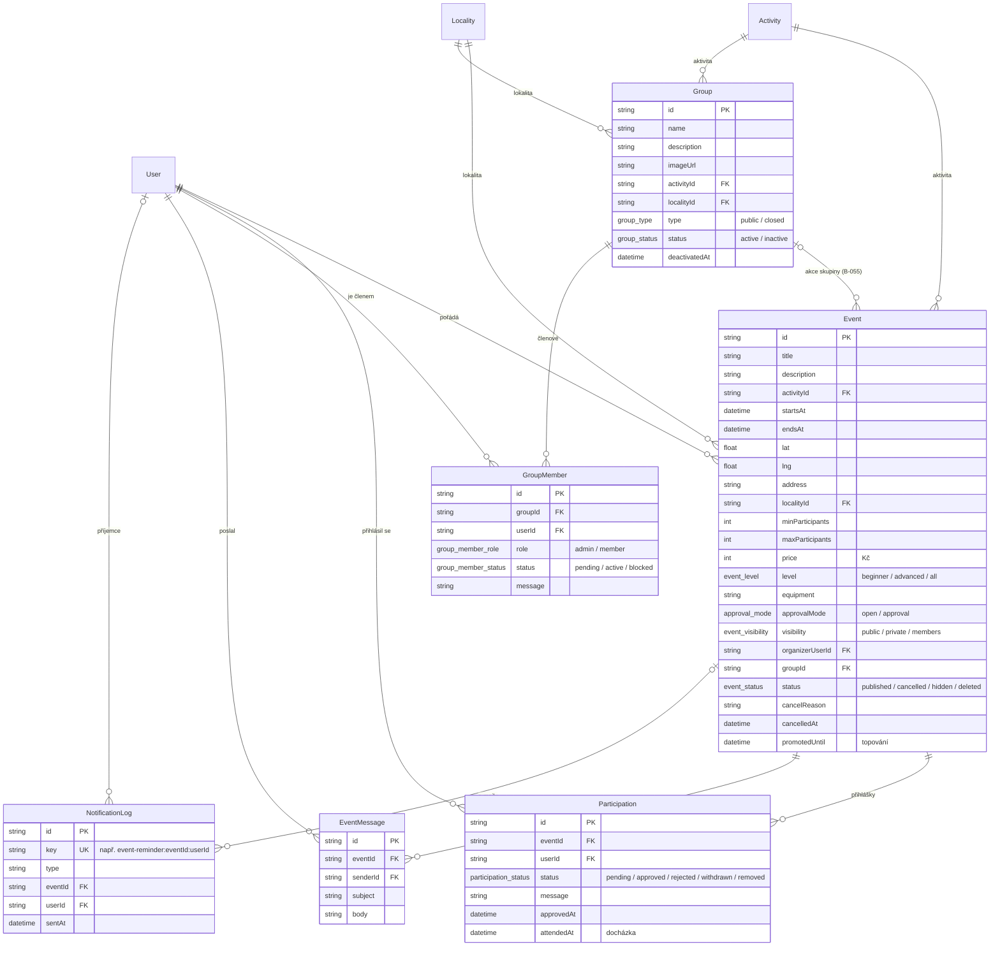
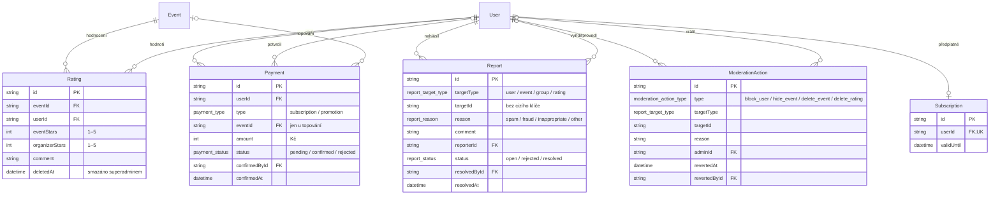

# Datový model HobbyHub (MVP)

Datový model pro celé MVP, tedy user stories US-01 až US-19 a úkoly v [BACKLOG.md](../BACKLOG.md). Zdrojem pravdy je [`apps/backend/prisma/schema.prisma`](../apps/backend/prisma/schema.prisma). Tento dokument ho jen přehledně ukazuje, při změně schématu ho aktualizuj.

Schéma vzniklo v rámci #47 (testovací data), protože bez něj nešla data nahrát do databáze. Obsahuje i modely pro úkoly po sprintu 2, aby se tabulky nemusely přidávat po kouscích a aby bylo vidět, jak spolu souvisí. Úkoly, které model zavádějí (B-002, B-020, …), schéma jen „předplní“. Jejich API, logika a testy zůstávají na nich.

## Přehled tabulek

| Model              | Tabulka             | K čemu je                                                                                | Úkol                | Sprint 2 |
| ------------------ | ------------------- | ---------------------------------------------------------------------------------------- | ------------------- | -------- |
| `User`             | `user`              | Účet (BetterAuth) a profil: bio, domovská lokalita, viditelnost údajů, souhlasy, blokace | B-003, B-013, B-014 | ano      |
| `UserInterest`     | `user_interest`     | Zájmy v profilu, vazba M:N uživatel × aktivita                                           | B-003               | ano      |
| `ActivityCategory` | `activity_category` | Kategorie aktivit (první úroveň)                                                         | B-002               | ano      |
| `Activity`         | `activity`          | Aktivita (druhá úroveň) s klíčovými slovy pro hledání                                    | B-002               | ano      |
| `Locality`         | `locality`          | Město nebo městská část se souřadnicemi středu                                           | B-002               | ano      |
| `Event`            | `event`             | Akce jednotlivce i skupiny                                                               | B-020               | ano      |
| `Participation`    | `participation`     | Přihláška na akci a její stav, docházka                                                  | B-030, B-072        | ano      |
| `Group`            | `group`             | Skupina (veřejná / neveřejná, aktivní / deaktivovaná)                                    | B-050               | ano      |
| `GroupMember`      | `group_member`      | Členství a role ve skupině                                                               | B-050               | ano      |
| `EventMessage`     | `event_message`     | Zpráva organizátora účastníkům (limit 10 za den)                                         | B-042               | ne       |
| `NotificationLog`  | `notification_log`  | Záznam o odeslaném plánovaném e-mailu, aby nepřišel dvakrát                              | B-043               | ne       |
| `Rating`           | `rating`            | Hodnocení akce a organizátora                                                            | B-060               | ne       |
| `Report`           | `report`            | Nahlášení uživatele, akce, skupiny nebo hodnocení                                        | B-061               | ne       |
| `ModerationAction` | `moderation_action` | Zásah superadmina a jeho vrácení                                                         | B-063               | ne       |
| `Payment`          | `payment`           | Simulovaná platba (předplatné, topování)                                                 | B-070               | ne       |
| `Subscription`     | `subscription`      | Předplatné organizátora (evidence docházky)                                              | B-071               | ne       |

Tabulky `session`, `account` a `verification` spravuje BetterAuth (přihlášení, ověření e-mailu, obnova hesla). Tabulka `quack` patří vzorové feature šablony a zmizí s B-085.

## Uživatelé a číselníky

## Akce a skupiny

## Důvěra, administrace a monetizace

Všechny tabulky kromě `user_interest` a číselníků mají navíc `createdAt` a většina i `updatedAt`. V diagramech je pro přehlednost vynechávám.

## Pravidla, která hlídá aplikace, ne databáze

Databáze vynucuje jen cizí klíče, unikátnost a enumy. Tato pravidla musí hlídat backend a pokrýt je testy:

- **Kapacita (B-020, B-030):** `approvedCount`, `missingToMin`, `freeSpots`, `isFull` se počítají jen ze schválených účastí. Organizátor do kapacity patří, jen když je sám přihlášený (Q12). Kontrola kapacity a zápis účasti v jedné transakci (B-031).
- **Jedna přihláška na akci a jedno členství ve skupině:** v databázi unikátní dvojice `eventId + userId` a `groupId + userId`. Opakovaná žádost proto mění stav existujícího záznamu, nevytváří nový.
- **Hodnocení 1–5 hvězd** a jen po skončení akce, kde byl uživatel schválený (B-060).
- **Poslední správce skupiny** se nemůže vzdát role ani odejít (B-054).
- **Akce se fyzicky nemaže** (Q11): zrušení = `status = cancelled`, zásah superadmina = `hidden` / `deleted`. Skupina se jen deaktivuje (B-051).
- **Nahlášení** odkazuje na cíl přes `targetType` + `targetId` bez cizího klíče, existenci cíle ověřuje backend.

## Rozhodnutí nad rámec popisu v backlogu

Backlog popisuje modely v bodech. Tyto věci v něm výslovně nejsou a schéma je doplňuje:

| Co                                                                                                                                        | Proč                                                                                             |
| ----------------------------------------------------------------------------------------------------------------------------------------- | ------------------------------------------------------------------------------------------------ |
| `Participation.approvedAt`                                                                                                                | Design D-03 řadí účastníky „podle data schválení“, `updatedAt` se mění i při jiných změnách      |
| `photoVisibility`, `bioVisibility`, `pastEventsVisibility`                                                                                | B-014 je chce, v seznamu polí B-003 chybí. Fotka profilu je existující pole `image` z BetterAuth |
| `UserInterest` jako vlastní tabulka                                                                                                       | B-003 chce M:N vazbu; vlastní tabulka má čitelný název a jde do ní přidat sloupec                |
| `EventMessage`                                                                                                                            | B-042 omezuje počet zpráv na 10 za den, bez záznamu o odeslání to nejde spočítat                 |
| `NotificationLog`                                                                                                                         | B-043 chce „záznam o odeslání, aby po restartu nepřišel e-mail dvakrát“                          |
| `Rating.deletedAt`, `ModerationAction.revertedAt`                                                                                         | B-063: smazání hodnocení musí jít vrátit, proto se hodnocení jen označí                          |
| `Report.resolvedById`, `resolvedAt`                                                                                                       | Historie v administraci (B-062, B-063) potřebuje vědět, kdo a kdy nahlášení vyřídil              |
| Uživatel s pořádanými akcemi nebo platbami a skupina s akcemi nejdou smazat (`RESTRICT`), přihlášky a členství se mažou s akcí / skupinou | Akce a platby jsou historie. Smazání účtu (B-080) uživatele anonymizuje, nemaže                  |

## Co se seeduje

Seed (`apps/backend/src/scripts/seed/`) je opakovatelný a běží lokálně při `pnpm dev` i na stagingu při každém startu kontejneru:

1. **Číselník aktivit a lokalit** vždy, srovná se s `demo-data.ts` (nic nemaže).
2. **Superadmin** z `SUPERADMIN_EMAIL` / `SUPERADMIN_PASSWORD`, když chybí.
3. **Testovací data #47** (41 uživatelů, 10 skupin, 59 akcí, 204 účastí), jen do databáze bez akcí a skupin. Vypnout jde `SEED_DEMO_DATA=false`.

Demo účty jsou v [README](../README.md#seeded-users).
