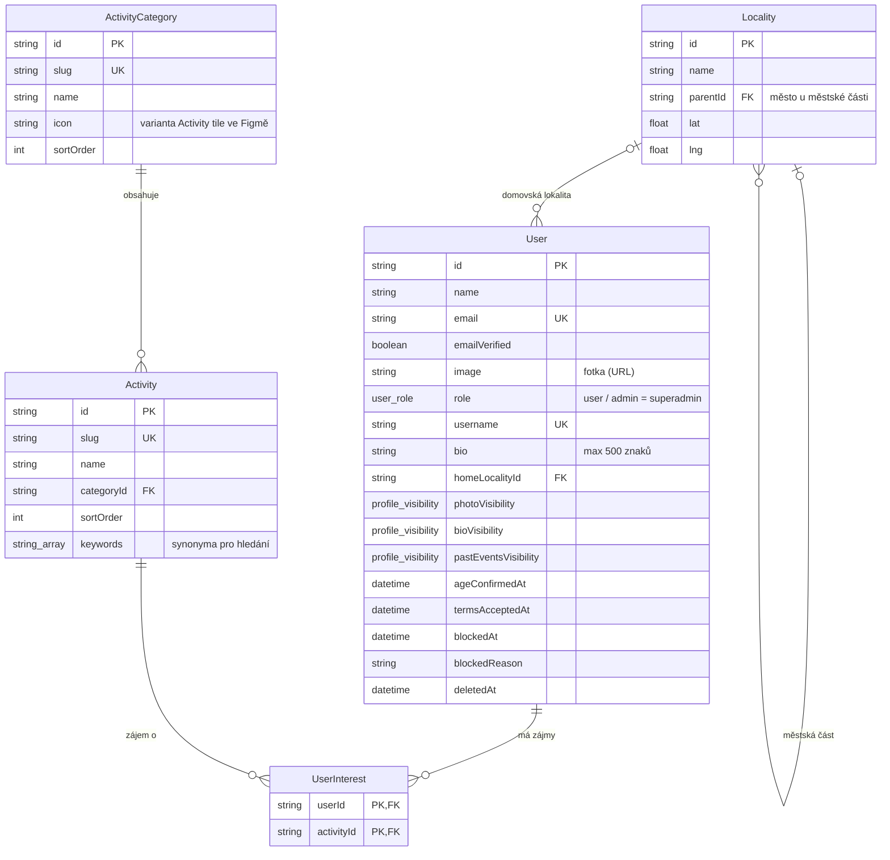
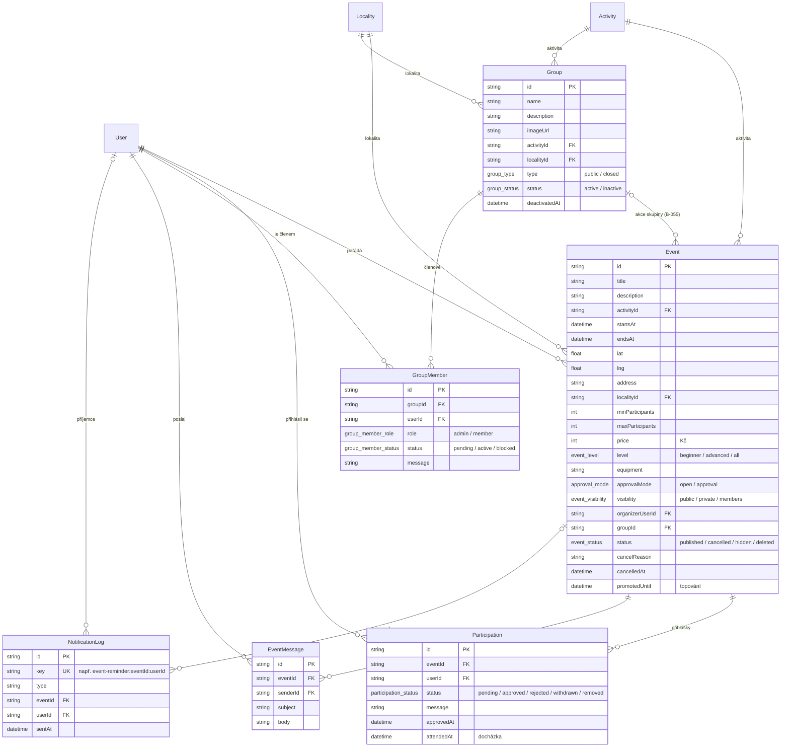

# Datový model HobbyHub (MVP)

Datový model pro celé MVP, tedy user stories US-01 až US-19 a úkoly v [BACKLOG.md](../BACKLOG.md). Zdrojem pravdy je [`apps/backend/prisma/schema.prisma`](../apps/backend/prisma/schema.prisma). Tento dokument ho jen přehledně ukazuje, při změně schématu ho aktualizuj.

Schéma vzniklo v rámci #47 (testovací data), protože bez něj nešla data nahrát do databáze. Obsahuje i modely pro úkoly po sprintu 2, aby se tabulky nemusely přidávat po kouscích a aby bylo vidět, jak spolu souvisí. Úkoly, které model zavádějí (B-002, B-020, …), schéma jen „předplní“. Jejich API, logika a testy zůstávají na nich.

## Přehled tabulek

| Model               | Tabulka              | K čemu je                                                                                | Úkol                | Sprint 2 |
| ------------------- | -------------------- | ---------------------------------------------------------------------------------------- | ------------------- | -------- |
| `User`              | `user`               | Účet (BetterAuth) a profil: bio, domovská lokalita, viditelnost údajů, souhlasy, blokace | B-003, B-013, B-014 | ano      |
| `UserInterest`      | `user_interest`      | Zájmy v profilu, vazba M:N uživatel × aktivita                                           | B-003               | ano      |
| `ActivityCategory`  | `activity_category`  | Kategorie aktivit (první úroveň)                                                         | B-002               | ano      |
| `Activity`          | `activity`           | Aktivita (druhá úroveň) s klíčovými slovy pro hledání                                    | B-002               | ano      |
| `Locality`          | `locality`           | Město nebo městská část se souřadnicemi středu                                           | B-002               | ano      |
| `Event`             | `event`              | Akce jednotlivce i skupiny                                                               | B-020               | ano      |
| `Participation`     | `participation`      | Přihláška na akci a její stav, docházka                                                  | B-030, B-072        | ano      |
| `Group`             | `group`              | Skupina (veřejná / neveřejná, aktivní / deaktivovaná)                                    | B-050               | ano      |
| `GroupMember`       | `group_member`       | Členství a role ve skupině                                                               | B-050               | ano      |
| `EventMessage`      | `event_message`      | Zpráva organizátora účastníkům (limit 10 za den)                                         | B-042               | ne       |
| `NotificationLog`   | `notification_log`   | Záznam o odeslaném plánovaném e-mailu, aby nepřišel dvakrát                              | B-043               | ne       |
| `Rating`            | `rating`             | Hodnocení akce a organizátora od účastníka                                               | B-060               | ne       |
| `ParticipantRating` | `participant_rating` | Hodnocení účastníka organizátorem akce                                                   | B-060, #180         | ne       |
| `Report`            | `report`             | Nahlášení uživatele, akce, skupiny nebo hodnocení                                        | B-061               | ne       |
| `ModerationAction`  | `moderation_action`  | Zásah superadmina a jeho vrácení                                                         | B-063               | ne       |
| `Payment`           | `payment`            | Simulovaná platba (předplatné, topování)                                                 | B-070               | ne       |
| `Subscription`      | `subscription`       | Předplatné organizátora (evidence docházky)                                              | B-071               | ne       |
| `SeedState`         | `seed_state`         | Verze testovacích dat v databázi, podle ní seed pozná, že má data vyměnit                | #181                | –        |

Tabulky `session`, `account` a `verification` spravuje BetterAuth (přihlášení, ověření e-mailu, obnova hesla).

## Uživatelé a číselníky

## Akce a skupiny

## Důvěra, administrace a monetizace

```mermaid
erDiagram
    Event ||--o{ Rating : "hodnocení"
    User ||--o{ Rating : "hodnotí"
    Event ||--o{ ParticipantRating : "hodnocení účastníků"
    Participation ||--o| ParticipantRating : "hodnocení účastníka"
    User ||--o{ Report : "nahlásil"
    User |o--o{ Report : "vyřídil"
    User ||--o{ ModerationAction : "provedl"
    User |o--o{ ModerationAction : "vrátil"
    User ||--o{ Payment : "platí"
    User |o--o{ Payment : "potvrdil"
    Event |o--o{ Payment : "topování"
    User ||--o| Subscription : "předplatné"

    Rating {
        string id PK
        string eventId FK
        string userId FK
        int eventStars "1–5"
        int organizerStars "1–5"
        string comment
        datetime deletedAt "smazáno superadminem"
    }
    ParticipantRating {
        string id PK
        string eventId FK
        string participantId FK "s eventId cizí klíč na účast"
        int stars "1–5, CHECK v databázi"
        datetime deletedAt "smazáno superadminem"
    }
    Report {
        string id PK
        report_target_type targetType "user / event / group / rating"
        string targetId "bez cizího klíče"
        report_reason reason "spam / fraud / inappropriate / other"
        string comment
        string reporterId FK
        report_status status "open / rejected / resolved"
        string resolvedById FK
        datetime resolvedAt
    }
    ModerationAction {
        string id PK
        moderation_action_type type "block_user / hide_event / delete_event / delete_rating"
        report_target_type targetType
        string targetId
        string reason
        string adminId FK
        datetime revertedAt
        string revertedById FK
    }
    Payment {
        string id PK
        string userId FK
        payment_type type "subscription / promotion"
        string eventId FK "jen u topování"
        int amount "Kč"
        payment_status status "pending / confirmed / rejected"
        string confirmedById FK
        datetime confirmedAt
    }
    Subscription {
        string id PK
        string userId FK, UK
        datetime validUntil
    }
```

Všechny tabulky kromě `user_interest` a číselníků mají navíc `createdAt` a většina i `updatedAt`. V diagramech je pro přehlednost vynechávám.

## Pravidla, která hlídá aplikace, ne databáze

Databáze vynucuje cizí klíče, unikátnost a enumy, k tomu jediný `CHECK`: hvězdičky 1–5 v `participant_rating` (Prisma ho ve schématu neumí zapsat, je jen v migraci). Tato pravidla musí hlídat backend a pokrýt je testy:

- **Kapacita (B-020, B-030):** `approvedCount`, `missingToMin`, `freeSpots`, `isFull` se počítají jen ze schválených účastí. Organizátor do kapacity patří, jen když je sám přihlášený (Q12). Kontrola kapacity a zápis účasti v jedné transakci (B-031).
- **Jedna přihláška na akci a jedno členství ve skupině:** v databázi unikátní dvojice `eventId + userId` a `groupId + userId`. Opakovaná žádost proto mění stav existujícího záznamu, nevytváří nový.
- **Hodnocení akce a organizátora (`Rating`) 1–5 hvězd** a jen po skončení akce, kde byl uživatel schválený (B-060).
- **Hodnocení účastníka (`ParticipantRating`, #180):** jen organizátor akce, jen `approved` účastníka, jen po skončení akce (`endsAt`, když chybí, `startsAt`), ne zrušené a ne sám sebe. Čistá funkce `decideParticipantRating` v [`modules/rating/domain/participant-rating.ts`](../apps/backend/src/modules/rating/domain/participant-rating.ts). Jedno na účastníka a akci a hvězdičky 1–5 hlídá databáze.
- **Průměrné hodnocení v profilu (#178, #179):** jako organizátor z `Rating.organizerStars`, jako účastník z `ParticipantRating.stars`; zaokrouhlené na jedno desetinné místo, vždy s počtem, bez hodnocení `null`. Smazaná hodnocení se nepočítají, akce skupin se osobě jako organizátorovi nepočítají. Čisté funkce v [`modules/rating/domain/rating-summary.ts`](../apps/backend/src/modules/rating/domain/rating-summary.ts).
- **Poslední správce skupiny** se nemůže vzdát role ani odejít (B-054).
- **Akce se fyzicky nemaže** (Q11): zrušení = `status = cancelled`, zásah superadmina = `hidden` / `deleted`. Skupina se jen deaktivuje (B-051).
- **Nahlášení** odkazuje na cíl přes `targetType` + `targetId` bez cizího klíče, existenci cíle ověřuje backend.

## Rozhodnutí nad rámec popisu v backlogu

Backlog popisuje modely v bodech. Tyto věci v něm výslovně nejsou a schéma je doplňuje:

| Co                                                                                                                                        | Proč                                                                                                                                                                          |
| ----------------------------------------------------------------------------------------------------------------------------------------- | ----------------------------------------------------------------------------------------------------------------------------------------------------------------------------- |
| `Participation.approvedAt`                                                                                                                | Design D-03 řadí účastníky „podle data schválení“, `updatedAt` se mění i při jiných změnách                                                                                   |
| `photoVisibility`, `bioVisibility`, `pastEventsVisibility`                                                                                | B-014 je chce, v seznamu polí B-003 chybí. Fotka profilu je existující pole `image` z BetterAuth                                                                              |
| `UserInterest` jako vlastní tabulka                                                                                                       | B-003 chce M:N vazbu; vlastní tabulka má čitelný název a jde do ní přidat sloupec                                                                                             |
| `EventMessage`                                                                                                                            | B-042 omezuje počet zpráv na 10 za den, bez záznamu o odeslání to nejde spočítat                                                                                              |
| `NotificationLog`                                                                                                                         | B-043 chce „záznam o odeslání, aby po restartu nepřišel e-mail dvakrát“                                                                                                       |
| `Rating.deletedAt`, `ParticipantRating.deletedAt`, `ModerationAction.revertedAt`                                                          | B-063: smazání hodnocení musí jít vrátit, proto se hodnocení jen označí                                                                                                       |
| `ParticipantRating` jako vlastní tabulka se složeným cizím klíčem `(eventId, participantId)` na účast                                     | Stejný tvar jako `Rating`, přihlašování (`participation`) se nemění; databáze zaručí, že hodnocený byl na akci přihlášený. Bez `raterId`: hodnotí jen organizátor akce (#180) |
| `CHECK` na `participant_rating.stars`                                                                                                     | Hvězdičky hlídá i databáze; `Rating` ho zatím nemá (možné navazující vylepšení)                                                                                               |
| `Report.resolvedById`, `resolvedAt`                                                                                                       | Historie v administraci (B-062, B-063) potřebuje vědět, kdo a kdy nahlášení vyřídil                                                                                           |
| Uživatel s pořádanými akcemi nebo platbami a skupina s akcemi nejdou smazat (`RESTRICT`), přihlášky a členství se mažou s akcí / skupinou | Akce a platby jsou historie. Smazání účtu (B-080) uživatele anonymizuje, nemaže                                                                                               |

## Co se seeduje

Seed (`apps/backend/src/scripts/seed/`) je opakovatelný a běží lokálně při `pnpm dev` i na stagingu při každém startu kontejneru:

1. **Číselník aktivit a lokalit** vždy, srovná se s `demo-data.ts` (nic nemaže).
2. **Superadmin** z `SUPERADMIN_EMAIL` / `SUPERADMIN_PASSWORD`, když chybí.
3. **Testovací data**, v produkci jen se `SEED_DEMO_DATA=true`, které má staging v `Dockerfile.deploy`; jinde vypnout jde `SEED_DEMO_DATA=false`:
   - demo data #47 (41 uživatelů, 10 skupin, 59 akcí v Praze),
   - komunita #150 (133 uživatelů, 16 skupin, 304 nadcházejících akcí po Česku); od #181 v ní jsou akce krajských měst, aby měla každá běžná aktivita v Praze a každém krajském městě aspoň 2 akce ([`regional-data.ts`](../apps/backend/src/scripts/seed/data/regional-data.ts)),
   - akce skupin #181 (každá aktivní skupina má nadcházející veřejnou akci a akci jen pro členy, 50 akcí; [`group-events-data.ts`](../apps/backend/src/scripts/seed/data/group-events-data.ts)),
   - proběhlé akce a hodnocení #180 (4 akce demo uživatelů s ukázkovými průměry v [`rating-data.ts`](../apps/backend/src/scripts/seed/data/rating-data.ts)) a #181 (104 dalších proběhlých akcí po Česku i ve skupinách, 3 zrušené; [`past-data.ts`](../apps/backend/src/scripts/seed/data/past-data.ts)); celkem 339 hodnocení akce a organizátora a 314 hodnocení účastníků.

   Účty se jen doplní. Ostatní data mají verzi (#181): `SEED_DATA_VERSION` v [`seed-content.ts`](../apps/backend/src/scripts/seed/seed/seed-content.ts) proti řádku v `seed_state`. Při rozdílu seed v jedné transakci smaže akce a skupiny, které vložil předchozí seed (jejich id jsou v `seed_state.eventIds` a `groupIds`; data před #181 pozná podle obsahu), vrátí profily seedových účtů podle dat, vloží všechno znovu s čerstvými termíny a zapíše verzi i s id nových řádků. Co založili testeři, i pod demo účty, zůstane. Postup pro novou verzi je v [README](../README.md#test-data-versions-181).

Demo účty jsou v [README](../README.md#seeded-users).
