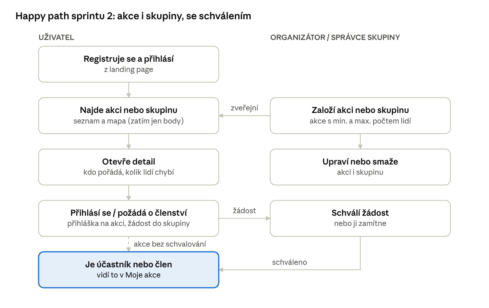

# HobbyHub – zápis z planningu sprintu 2

**Kdy:** 13. 10. 2026, 22 minut, online · **Kdo:** Jan Černý (product owner), tým HobbyHub · **Téma:** planning sprintu 2, scope MVP

Na konci sprintu 2 ukážeme živě na stagingu happy path pro akce i skupiny: objevení v seznamu a na mapě, vyhledání podle základních kritérií, detail, správu (vytvořit / upravit / smazat), přihlášení na akci a žádost o členství ve skupině se schválením. Hodnocení a další funkce kolem zatím neřešíme.

## Happy path

Happy path je průchod, který si v aplikaci ověří základní věci: „objevil jsem aplikaci, přihlásil se, viděl něčí akci, přečetl si, o čem je, a dal najevo, že přijdu.“ Skupina funguje podobně, liší se schvalovacím procesem.

**Potvrzeno PO 14. 10.:** _„Najdeš appku, zaregistruješ se a přihlásíš, vyhledáš si event nebo skupinu, co se ti líbí, podle různých kritérií, a přihlásíš se na event / požádáš o schválení do skupiny.“_

1. **Úvodní stránka:** návštěvník pochopí, k čemu HobbyHub je.
2. **Registrace a přihlášení:** stane se uživatelem.
3. **Seznam akcí s mapou:** prochází nadcházející akce v seznamu nebo jako body na mapě a filtruje je podle aktivity a lokality.
4. **Detail akce:** vidí, o čem akce je, kdo ji pořádá a kolik lidí chybí.
5. **Přihlášení na akci:** dá najevo, že přijde (u akce se schvalováním čeká na organizátora).
6. **Správa akce:** organizátor akci vytvoří, upraví nebo smaže a vidí přihlášky.
7. **Seznam skupin s filtrem, detail a správa skupiny:** stejné vzory jako u akcí, UX jen jasně ukáže, že jsem v jiné části.
8. **Žádost o členství ve skupině:** uživatel požádá, správce žádost přijme, uživatel je ve skupině. Co člen ve skupině dál dělá, zatím neřešíme.

## Scope sprintu 2

User stories z [HobbyHub_User_Stories_MVP.md](HobbyHub_User_Stories_MVP.md), které happy path pokrývají, osekané na to, co sprint potřebuje. Schvalování je ve scope. Mapa je nástřel: stačí zobrazit body; pokud narazí na velké problémy, přesune se do sprintu 3.

| Story                      | Původní | Bereme ve sprintu 2                                                                                               | Vynecháváme                                                                                                               |
| -------------------------- | ------- | ----------------------------------------------------------------------------------------------------------------- | ------------------------------------------------------------------------------------------------------------------------- |
| Úvodní stránka             | US-01   | Landing page: věta, co HobbyHub dělá, náhled nadcházejících akcí, vstup do registrace                             | Lokalita z IP (výchozí Praha)                                                                                             |
| Registrace a přihlášení    | US-04   | E-mail + heslo, 18+ a souhlasy, návrat na akci po přihlášení                                                      | Ověření e-mailu, zapomenuté heslo                                                                                         |
| Seznam a mapa akcí         | US-02   | Seznam nadcházejících akcí, přepnutí na mapu se špendlíky, filtr aktivita + lokalita (minimum, viz otázky pro PO) | Rozkliknutí špendlíku (pokud nezbude čas), řazení podle vzdálenosti; filtr termínu a hledání podle názvu k potvrzení s PO |
| Detail akce                | US-03   | Detail na vlastní URL bez přihlášení, „chybí ještě X“, organizátor                                                | Štítek „Zrušeno“ s důvodem                                                                                                |
| Založení akce              | US-11   | Formulář s min./max., schvalování ano/ne, místo na mapě + adresa                                                  | Cena, úroveň, vybavení (nepovinné, pokud zbude čas)                                                                       |
| Úprava a smazání akce      | US-13   | Úprava do začátku akce, zrušení nebo smazání (k potvrzení s PO)                                                   | E-maily přihlášeným                                                                                                       |
| Přihlášení na akci         | US-06   | „Přijdu“ nebo žádost, stažení žádosti, odhlášení, „Plno“                                                          | Zpráva k žádosti                                                                                                          |
| Schvalování účastníků      | US-12   | Seznam žádostí, schválit / zamítnout, seznam účastníků (schvalování u akcí k potvrzení s PO)                      | Hromadné schválení, zpráva účastníkům, e-maily                                                                            |
| Moje akce                  | US-07   | Záložky Přihlášen (vč. čekajících) a Pořádám, odkaz v navigaci (přidáno 18. 10., schválil PO, viz níže)           | Záložka Proběhlé                                                                                                          |
| Skupiny: založení a správa | US-16   | Založení, úprava, smazání; seznam skupin s filtrem aktivita + lokalita, detail skupiny                            | Jmenování dalších správců, obrázek                                                                                        |
| Členství ve skupině        | US-17   | Veřejná: „Přidat se“; neveřejná: žádost → schválení / zamítnutí; odchod                                           | Blokace člena, upozornění                                                                                                 |
| Testovací data             | F-64    | Seed akcí a skupin podle oblastí zájmu z briefu, ručně zkontrolovaný                                              | –                                                                                                                         |

**Změna scope 18. 10.:** Tým zařadil do sprintu 2 i Moje akce (US-07). Bez nich přihlášený uživatel nemá kde najít akce, na které se přihlásil, ani ty, které pořádá, a navigace by vedla do prázdna. V původní happy path od PO nebyly; rozšíření scope PO schválil 18. 10.

## Mimo scope

PO teď nechce řešit hodnocení a funkce kolem, rozšiřovaly by scope bez vlivu na happy path.

| Oblast                    | Stories             | Proč ne teď                                                       |
| ------------------------- | ------------------- | ----------------------------------------------------------------- |
| E-maily a ověření e-mailu | US-04 (část), US-08 | Napojení e-mailové služby a plánovač                              |
| Profil a GDPR             | US-05               | Viditelnost údajů, export a smazání účtu                          |
| Hodnocení                 | US-09               | PO: zatím nechceme                                                |
| Akce skupin a správci     | US-18, US-16 (část) | Skupina zatím jen ověřuje členství a schvalování                  |
| Moderace                  | US-10, US-19        | Role superadmin a administrace                                    |
| Monetizace                | US-14, US-15        | Simulované platby; závisí na administraci                         |
| Interaktivní mapa         | US-02 (část)        | Náhled po klepnutí na špendlík, pokud nezbude čas; jinak sprint 3 |

## Dohody

**Design**

- Před zadáním agentovi navrhneme a s PO schválíme design jedné typické obrazovky (seznam nebo detail akce) na mobilu i desktopu. Ne landing page, ta vypadá jinak než zbytek aplikace.
- Hi-fi všech obrazovek nedělat. Stačí ukázka seznamu, detailu a formuláře; agent další obrazovky odvodí.
- Wireframy jsou dobrý základ. Primární zařízení je mobil, superadmin jen desktop.
- Aplikace má mít trochu brandu, nejen shadcn s barevnými tlačítky. Design systém s tokeny (např. shadcn) je doporučený, ne povinný.
- Design schvalovat průběžně, i asynchronně v Teams, ne až na poslední chvíli.

**Backlog**

- Relevantní user stories dáme do GitHubu a posouváme Backlog → Ready / Sprint backlog → Done.
- Backlog sprintu 2 (user stories a úkoly): <https://github.com/orgs/applifting-vsecourse/projects/16>
- PO projde popisy úkolů a upozorní na nesmysly od AI.
- Feature breakdown a backlog držíme aktuální a reagujeme na nová zjištění; Lean Canvas dál neladíme.

**Testovací data**

- Necháme AI vygenerovat data podle oblastí zájmu z briefu a ručně zkontrolujeme, jestli dávají smysl.

**Komunikace**

- Průběžně informovat PO: návrh, dotazy, výsledek běhu agenta, nalezené chyby. Klidně asynchronně v Teams.

**Co ukážeme na konci sprintu**

- Verzi nasazenou na stagingu; nasazovat průběžně a nerozbít ji těsně před demem.
- Otestovanou, bez chyb „na první pohled“, v souladu se schválenou specifikací.
- Demo jako živý průchod aplikací, bez PowerPointu.

## Úkoly

| Úkol                                                           | Kdo                                    |
| -------------------------------------------------------------- | -------------------------------------- |
| Poslat do Teams průlet happy path jako záznam scopingu         | Jan Černý (hotovo 14. 10.)             |
| Založit úkoly sprintu jako issues na GitHubu a rozdělit je     | Tým (založeno 14. 10., zbývá rozdělit) |
| Navrhnout design první obrazovky a poslat PO do Teams k review | Tým                                    |
| Vygenerovat a zkontrolovat testovací data                      | Tým (QA)                               |
| Potvrdit schůzku 19. 10. ve stejném mailovém vlákně            | Tým                                    |

## K prokonzultování s PO 19. 10.

1. **Moje akce (US-07):** vyřešeno, PO 18. 10. schválil zařazení do sprintu 2 (viz Změna scope).
2. **Kritéria vyhledávání:** stačí u akcí i skupin filtr aktivita + lokalita, nebo chce PO už teď i termín a hledání podle názvu?
3. **Smazání, nebo zrušení:** má „D“ v CRUD u akcí a skupin záznam smazat, nebo zrušit se štítkem „Zrušeno“ (přihlášení pak vidí, co se stalo)?
4. **Schvalování u akcí:** má mít organizátor akce volbu „schvaluji přihlášky“, nebo stačí „Přijdu“ a schvalování jen u skupin?
5. **Odchylky designu od wireframů:** návštěvník nevidí „Založit akci“, zakládá se plovoucím tlačítkem, Skupiny jsou ve spodní navigaci (podrobně v [design-rozhodnuti.md](design-rozhodnuti.md)). Odsouhlasit.

## Další schůzka

Pondělí 19. 10. v 15:30, asi 15 minut, před cvičením. Termín ještě potvrdíme s ostatními z týmu; posun o 15 minut stačí napsat.
